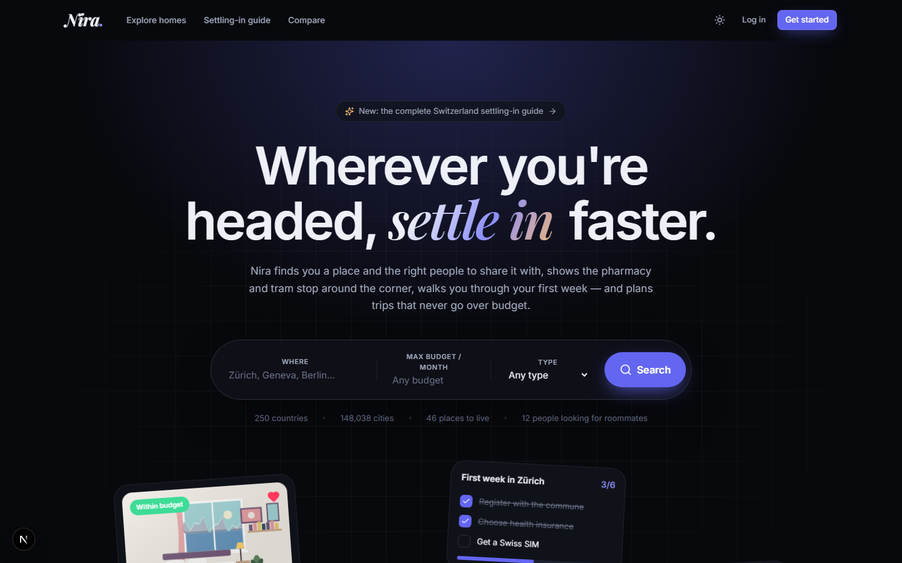
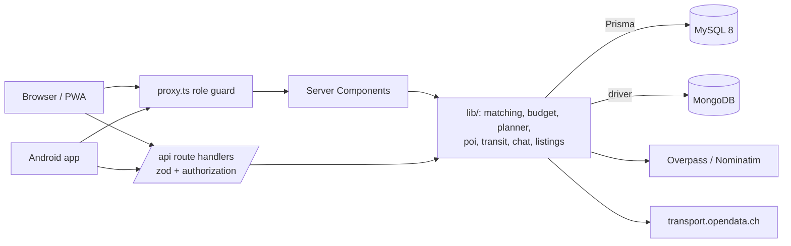

# Nira.

**Wherever you're headed, Nira gets you settled.**

Nira is a full-stack platform for people **moving to a new country** and for people **planning a
trip**. Find a room and the right people to share it with, see the pharmacy and tram stop around
the corner, follow a step-by-step settling-in guide, chat safely inside the app, and generate trip
plans that never go over budget. Switzerland is the best-covered destination; nothing is
hard-coded to it — every country, region and city comes from the database.

DBMS Level 3 project · Next.js 16 · TypeScript · **MySQL 8** (Prisma 6) · **MongoDB 7** · Tailwind CSS 4 · Leaflet/OpenStreetMap · Android via Capacitor



---

## Contents
- [Features](#features) · [Tech stack](#tech-stack) · [Architecture](#architecture)
- [Quick start](#quick-start) · [Environment](#environment) · [Demo accounts](#demo-accounts)
- [Database highlights](#database-highlights) · [Run on a phone / Android](#run-on-a-phone--android)
- [Scripts](#scripts) · [Testing](#testing) · [Project structure](#project-structure)
- [Team](#team) · [Known limitations](#known-limitations) · [Documentation](#documentation)

## Features

**Three roles.** `USER` (moving or travelling), `BUSINESS` (dorms, landlords, agencies) and `ADMIN`.
After login a user picks **Relocate** or **Trip** mode and can switch any time.

| | |
|---|---|
| **Housing search** | Country → region → city cascade, type, price, open spots, gender rule, move-in date, bedrooms, amenities, furnished, keywords (FULLTEXT); sort by newest, price or distance; 12 per page; filters live in the URL; "within budget" badges from your profile; map view with price pins. |
| **Listing pages** | Photo mosaic + lightbox, facts, amenities, house rules, price insight ("cheaper than 72 % of places in Zürich" – window function), map, owner card, message owner, save, people looking to share, nearby essentials, report. |
| **Roommates** | Post a request on any shareable place (one open request per person, enforced by the DB); compatibility score 0–100 (TypeScript + SQL view); top matches; owners accept in a locking transaction that fills the place and closes the rest. |
| **Chat** | Either side can start; one conversation per pair and place; unread badges; 3-second polling that only fetches new messages and pauses in background tabs; read receipts; block and report. No phone numbers or emails are ever shown. |
| **Nearby essentials** | Supermarkets, pharmacies, hospitals, doctors, transit stops, SIM shops, banks, ATMs, laundry, gyms, universities, post, police — live from OpenStreetMap, cached in MySQL for 7 days, with estimated prices for food. |
| **Settling-in guide** | Database-driven articles, a first-week checklist that remembers your progress, SIM plans, transport modes and passes, **live Swiss connections**, healthcare, banking, groceries, emergency numbers, cost of living, full-text search, admin editor. |
| **Trip planner** | City, days, people, budget, style, pace, interests and a budget split → day-by-day plan (stay, meals, sights, transport) clustered by distance, with a live budget meter, swap/add/remove, regenerate, duplicate, print and a read-only share link. |
| **Business dashboard** | Listings, views (14-day chart), inquiries, open requests; create/edit with geocoding and a draggable pin; photo upload, reorder, cover, captions; archive, mark rented (stored procedure). |
| **Admin** | Users (search, deactivate, verify, roles), listing moderation, reports queue, guide and cost content CRUD, audit log, Mongo message stats. |
| **Everywhere** | Dark/light theme, responsive with a native-style bottom tab bar on phones, accessible forms and focus states, skeletons, empty states, error pages, toasts, installable PWA, Android app. |

## Tech stack

| Layer | Choice |
|---|---|
| Web app | Next.js 16 (App Router, Server Components, Route Handlers, `proxy.ts`), React 19, TypeScript (strict) |
| UI | Tailwind CSS 4, lucide icons, sonner toasts, Leaflet + OpenStreetMap tiles |
| Auth | NextAuth v5 (credentials, JWT with id + role), bcryptjs |
| Relational DB | **MySQL 8** via Prisma 6 + raw SQL migrations (views, function, procedure, triggers, CHECKs, FULLTEXT) |
| Document DB | **MongoDB 7** (official driver): chat messages and notifications |
| Validation | zod on every API input + database constraints |
| External data | OSM Overpass (places), Nominatim (geocoding), transport.opendata.ch (Swiss timetable), open.er-api.com (exchange rates), Cloudinary (optional photo storage) |
| Mobile | PWA (manifest, service worker) + Capacitor Android project |
| Tests | Vitest (79 tests) |

## Architecture



MySQL holds everything relational (accounts, listings, locations, requests, guide, prices, trips,
audit) and enforces the important rules itself. MongoDB holds append-only chat message bodies and
expiring notifications; the conversation *header* stays in MySQL. Reasoning:
[docs/report.md §5.2](docs/report.md#52-database-choice-and-justification) and
[docs/nosql-design.md](docs/nosql-design.md).

## Quick start

Requirements: **Node.js 20+**, and either **Docker** or a local MySQL 8 + MongoDB.

```bash
git clone https://github.com/mounika-200622/relocation-app.git
```

```bash
cd relocation-app
```

```bash
docker compose up -d
```

```bash
cp .env.example .env
```

```bash
npm install
```

```bash
npx prisma migrate deploy
```

```bash
npm run db:seed
```

```bash
npm run dev
```

Open http://localhost:3000.

- The seed loads **all 250 countries, ~5 000 regions and ~148 000 cities** (about 30 s). For a
  faster first run: `SEED_COUNTRIES=CH,DE,IN npm run db:seed`.
- **No Docker?** Point `DATABASE_URL` at your MySQL 8 (the user needs rights to create a shadow
  database for `migrate dev`, and `log_bin_trust_function_creators=1` if binary logging is on), and
  run `npm run mongo:local` in a second terminal for a persistent local MongoDB on port 27018
  (`MONGODB_URI="mongodb://127.0.0.1:27018"`).
- **Nearby places & trips** use live OpenStreetMap data. The public Overpass server can be slow;
  pre-fill the cache for the demo cities with `npx tsx scripts/poi-warm.ts`, or set `POI_OFFLINE=1`
  to work only from the cache.
- Upgrading a v1 database (photos stored as base64)? Run `npx prisma migrate deploy` then
  `npm run photos:migrate`.

## Environment

All configuration is in `.env` (never committed). See [`.env.example`](.env.example):

| Variable | Purpose |
|---|---|
| `DATABASE_URL` | MySQL connection string |
| `MONGODB_URI`, `MONGODB_DB` | MongoDB for chat and notifications |
| `AUTH_SECRET` | JWT signing secret (`npx auth secret`) |
| `AUTH_TRUST_HOST` | `true` – lets login work on localhost, LAN IPs and the Android app |
| `NEXTAUTH_URL` | Only for a real deployment |
| `ADMIN_EMAIL`, `ADMIN_PASSWORD` | The admin account created by the seed |
| `CLOUDINARY_*` | Optional photo hosting (otherwise `/public/uploads`) |
| `POI_PROVIDER`, `GOOGLE_PLACES_API_KEY` | `overpass` (default) or `google` |
| `OVERPASS_URL`, `NOMINATIM_USER_AGENT` | Map data endpoints and the identifying User-Agent |
| `POI_OFFLINE` | `1` = only use cached places |
| `NIRA_DEV_ORIGINS` | Your laptop's LAN IP, so phones can use the dev server |
| `RESEND_API_KEY`, `EMAIL_FROM` | Optional email for password resets (otherwise logged to the console) |

## Demo accounts

Password for every seeded person and business: **`NiraDemo#2026`**

| Role | Email | Notes |
|---|---|---|
| Admin | value of `ADMIN_EMAIL` (default `admin@nira.local`) | password = `ADMIN_PASSWORD` |
| Admin | `moderator@nira.app` | |
| User | `aarav@nira.app` | ETH student moving to Zürich: saved places, requests, chats, a trip |
| User | `priya@nira.app` | PhD student, Zürich, women-only roommate preference |
| User | `lena@nira.app`, `mateo@nira.app`, `amara@nira.app`, `rohan@nira.app` | Zürich seekers |
| User | `sofia@nira.app`, `chloe@nira.app` (Lausanne) · `yuki@nira.app`, `ethan@nira.app` (Geneva) · `noah@nira.app` (Basel) · `mia@nira.app` (Berlin) | |
| Business | `hello@alpinestudent.ch` | Verified; Zürich and Lausanne |
| Business | `rent@lakeview-residences.ch`, `team@helvetiaflats.ch` | Verified |
| Business | `casa@ticinohomes.ch`, `info@campusnest.ch` | Not verified |
| Business | `hi@citynest-global.com` | Berlin and Bengaluru |

## Database highlights

- **37 tables in 3NF**, 53 foreign keys with reasoned ON DELETE rules, **27 CHECK constraints**,
  112 indexes incl. composite and FULLTEXT — [data dictionary](docs/data-dictionary.md) ·
  [ER diagram](docs/er-diagram.md) · [normalization](docs/normalization.md) · [DDL](docs/schema.sql)
- **Views** `v_listing_summary` (powers search) and `v_roommate_compatibility` (powers top matches)
- **Stored function** `fn_distance_km` (Haversine, used for "nearest" and place radius search)
- **Stored procedure** `sp_mark_listing_rented` (transaction + row lock)
- **Triggers**: audit log of price/status changes, automatic RENTED when full, a partial-unique
  "one open request per person" rule, and rules MySQL can't express as CHECKs
- **Transactions** with `SELECT … FOR UPDATE` for the roommate accept race condition
- **Window functions** (RANK, PERCENT_RANK, DENSE_RANK, ROW_NUMBER, COUNT OVER) in app queries
- **MongoDB** aggregation pipelines, a partial index for unread messages and a TTL index
- 27 annotated queries with real output: [docs/queries.sql](docs/queries.sql)

## Run on a phone / Android

Full guide: [docs/android.md](docs/android.md). Short version (phone and laptop on the same Wi-Fi):

```bash
npm run dev:lan
```

- **Any phone:** open `http://<laptop-ip>:3000` in Chrome → ⋮ → *Add to Home screen*.
- **Android app:** set `NIRA_SERVER_URL=http://<laptop-ip>:3000`, then `npx cap sync android`
  and `npx cap open android` → Run ▶ in Android Studio (or `npm run android:apk` for an APK).

## Scripts

| Command | What it does |
|---|---|
| `npm run dev` / `dev:lan` | Dev server (LAN version listens on all interfaces) |
| `npm run build` / `start` / `start:lan` | Production build and server |
| `npm test` | Vitest unit tests |
| `npm run lint` / `npm run typecheck` | ESLint / TypeScript |
| `npm run db:migrate` | `prisma migrate deploy` |
| `npm run db:seed` | Idempotent seed (safe to re-run) |
| `npm run db:reset` | Drop, re-migrate and re-seed the database (asks Prisma for confirmation) |
| `npm run mongo:local` | Local MongoDB without Docker |
| `npm run photos:migrate` | Move v1 base64 photos into `ListingPhoto` |
| `npm run android:sync` / `android:open` / `android:apk` | Capacitor Android workflow |
| `npx tsx scripts/poi-warm.ts` | Pre-fill the place cache for the demo cities |
| `npx tsx scripts/docs/*.ts` | Regenerate the data dictionary, query samples and contributions |

## Testing

```bash
npm test
```

79 unit tests cover the roommate score, budget allocation and the never-over-budget ledger,
the trip planner, price tiers, Haversine, authorization rules (incl. open redirects), every
zod schema, the accept-request race rules, Overpass parsing and admin schemas. Database
behaviour (triggers, CHECKs, procedure, transactions) is exercised by `scripts/docs/queries.ts`.
Manual walkthrough: [docs/qa-checklist.md](docs/qa-checklist.md).

## Project structure

```
prisma/
  schema.prisma            relational model (37 tables)
  migrations/              v1 + v2 schema, SQL objects, indexes
  seed.ts, seed/           locations, guide, costs, demo data, trips
src/
  proxy.ts                 role-based page guard (Next 16 "middleware")
  app/                     pages (relocate, listings, roommates, essentials, guide, trip, chat,
                           business, admin, …) and api/ route handlers
  components/              design system, navbar/tab bar, map, listing, trip, profile …
  lib/                     auth, authz, api helpers, validators/, matching, budget, trip/,
                           poi/, transit/, mongo/, listings, roommates, chat, storage, fx …
tests/                     Vitest unit tests
scripts/                   mongo-local, poi-warm, legacy photo migration, docs generators
docs/                      report, ER diagram, schema.sql, data dictionary, queries, algorithms
android/, capacitor.config.ts, mobile/   Android app
```

## Team

| Member | GitHub |
|---|---|
| Member A | [mounika-200622](https://github.com/mounika-200622) |
| Member B | [pramitiudupa](https://github.com/pramitiudupa) |

Both members contributed to the database and the application; commits alternate between the
two. Breakdown by area: [docs/contributions.md](docs/contributions.md).

## Known limitations

- Chat uses 3-second polling, not WebSockets.
- Restaurant and attraction prices are **estimates** from price tiers and local cost data (OSM
  has no menus). Cost data is indicative (2025/26).
- The public Overpass server is sometimes overloaded; the app then serves cached places and
  says so. Use `scripts/poi-warm.ts` before a demo.
- Uploads go to `/public/uploads` unless Cloudinary is configured, which does not persist on
  serverless hosts.
- Live connections are implemented for Switzerland (provider interface ready for others).
- The in-memory rate limiter is per process (use Redis when scaling out).
- The Android app needs a reachable Nira server (LAN IP or a deployment).

## Documentation

[Project report](docs/report.md) · [ER diagram](docs/er-diagram.md) · [DDL](docs/schema.sql) ·
[Data dictionary](docs/data-dictionary.md) · [Normalization](docs/normalization.md) ·
[Queries](docs/queries.sql) · [NoSQL design](docs/nosql-design.md) ·
[Trip algorithm](docs/trip-algorithm.md) · [Matching algorithm](docs/matching-algorithm.md) ·
[Android](docs/android.md) · [QA checklist](docs/qa-checklist.md) · [Contributions](docs/contributions.md)

Map data © OpenStreetMap contributors (ODbL). Timetable data: transport.opendata.ch.
