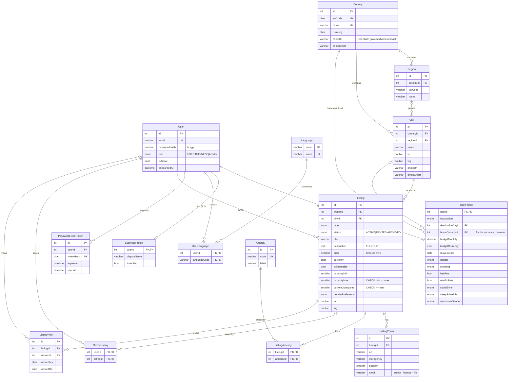
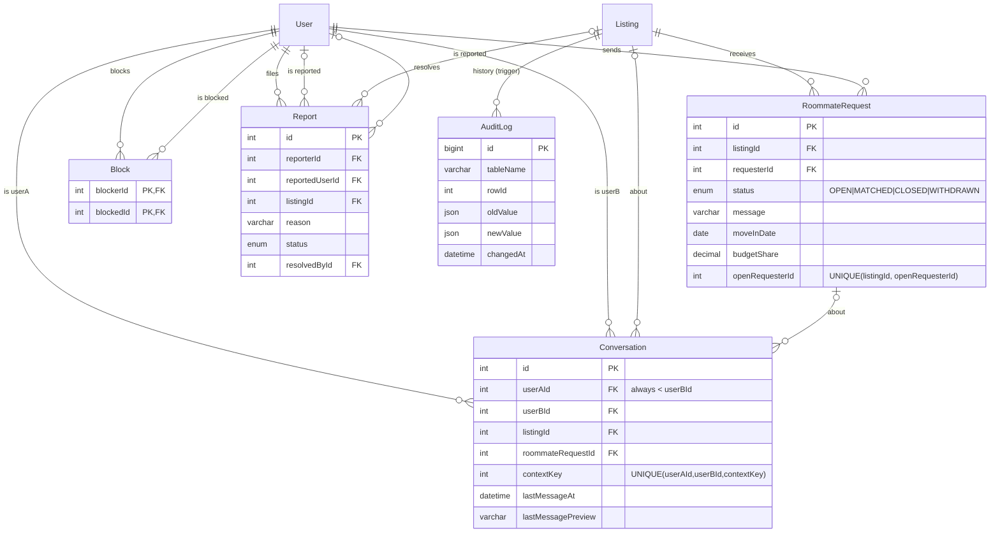
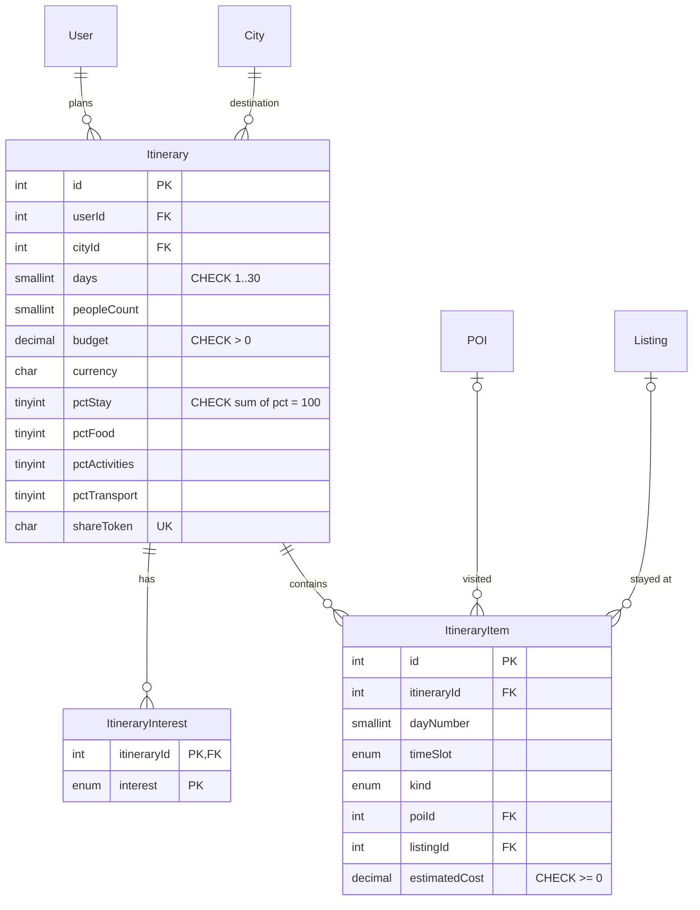
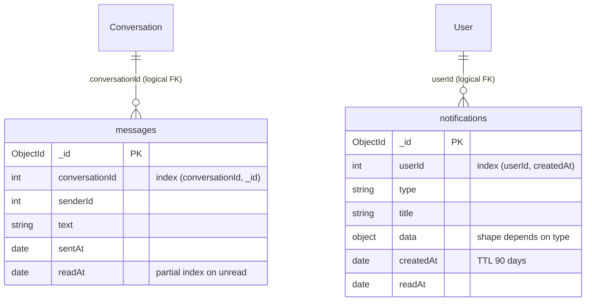

# ER diagram

Relational part (MySQL). Every table of `prisma/schema.prisma` appears below; attributes are
trimmed to keys and the most important columns — the full list is in
[data-dictionary.md](data-dictionary.md). MongoDB collections are shown at the end.

GitHub renders the Mermaid diagrams directly. To export a PNG:
`npx -y @mermaid-js/mermaid-cli -i docs/er-diagram.md -o docs/er-diagram.png`.

## 1. Accounts, locations and listings

## 2. Roommates, chat headers and moderation

## 3. Places, prices and the settling-in guide

```mermaid
erDiagram
    City |o--o{ POI : "cached in"
    Country ||--o{ CostEstimate : "prices"
    City |o--o{ CostEstimate : "city prices"
    Country ||--o{ GuideArticle : has
    City |o--o{ GuideArticle : "city-specific"
    Country ||--o{ ChecklistTemplate : has
    ChecklistTemplate ||--o{ UserChecklistProgress : "ticked in"
    User ||--o{ UserChecklistProgress : ticks
    Country ||--o{ SimProvider : has
    SimProvider ||--o{ SimPlan : offers
    Country ||--o{ TransportMode : has
    Country ||--o{ RideService : "taxis & ride apps"
    Country ||--o{ TransportPass : has
    City |o--o{ TransportPass : "city pass"
    Country ||--o{ EmergencyNumber : has
    Country ||--o{ SupermarketChain : has
    Country ||--o{ Bank : has

    POI {
        int id PK
        varchar osmId UK
        int cityId FK
        enum category
        varchar name
        double lat
        double lng
        tinyint priceTier "CHECK 1..4"
        json tags
        datetime lastSyncedAt
    }
    PoiQueryCache {
        int id PK
        varchar areaKey "UNIQUE(areaKey, category)"
        enum category
        datetime fetchedAt
    }
    CostEstimate {
        int id PK
        int countryId FK
        int cityId FK
        enum category
        tinyint tier
        decimal minPrice "CHECK min <= max"
        decimal maxPrice
        char currency
    }
    ExchangeRate {
        char base PK
        char quote PK
        decimal rate
        datetime fetchedAt
    }
    GuideArticle {
        int id PK
        int countryId FK
        enum category
        varchar slug "UNIQUE(countryId, slug)"
        varchar title "FULLTEXT"
        text body
        varchar sourceUrl
    }
    ChecklistTemplate {
        int id PK
        int countryId FK
        varchar title
        smallint dueWithinDays
    }
    UserChecklistProgress {
        int userId PK,FK
        int itemId PK,FK
        datetime completedAt
    }
    SimProvider {
        int id PK
        int countryId FK
        varchar name
        bool isMvno
    }
    SimPlan {
        int id PK
        int providerId FK
        enum kind
        decimal priceMonthly
        decimal dataGb "NULL = unlimited"
    }
    TransportMode {
        int id PK
        int countryId FK
        enum mode
    }
    RideService {
        int id PK
        int countryId FK
        varchar name "UK with countryId"
        enum kind "RIDE_HAILING, TAXI, BIKE_SHARE, SCOOTER"
        varchar deepLink "CHECK: needs website or deepLink"
    }
    TransportPass {
        int id PK
        int countryId FK
        int cityId FK
        decimal price
        enum audience
    }
    EmergencyNumber {
        int id PK
        int countryId FK
        varchar service
        varchar number
    }
    SupermarketChain {
        int id PK
        int countryId FK
        tinyint priceTier
    }
    Bank {
        int id PK
        int countryId FK
        bool studentAccount
    }
```

## 4. Trip planner

## 5. MongoDB (NoSQL) collections

