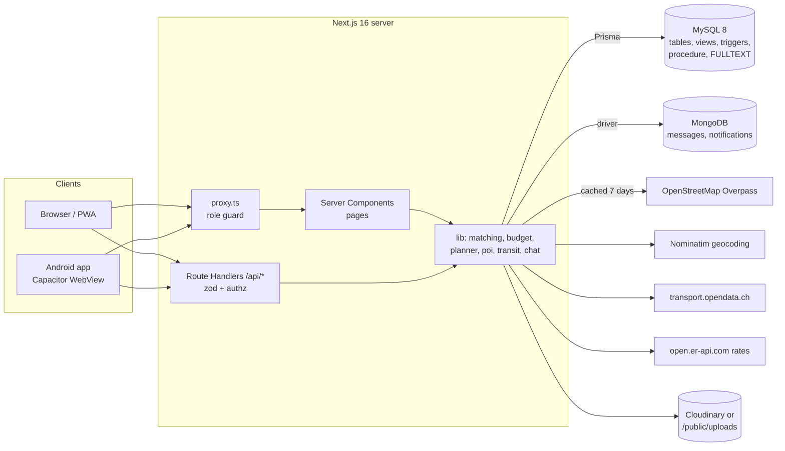
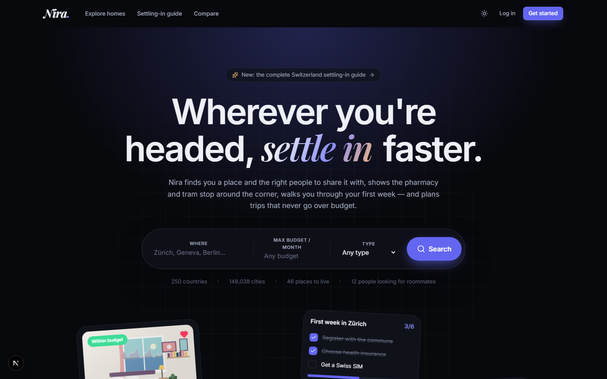
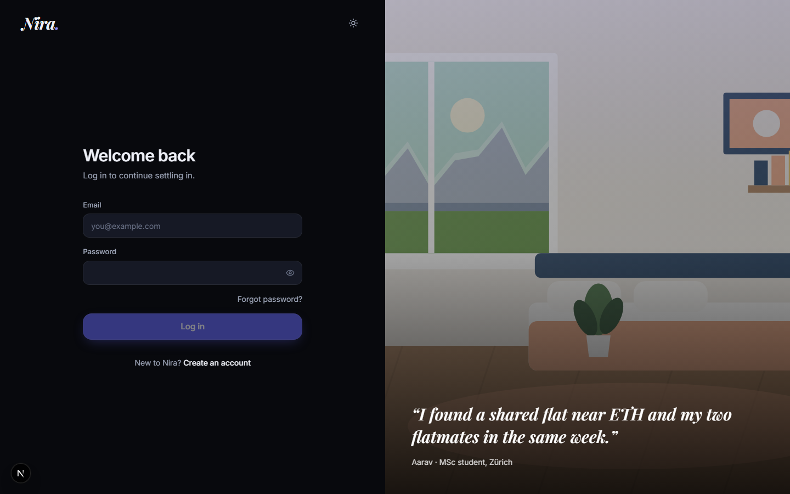
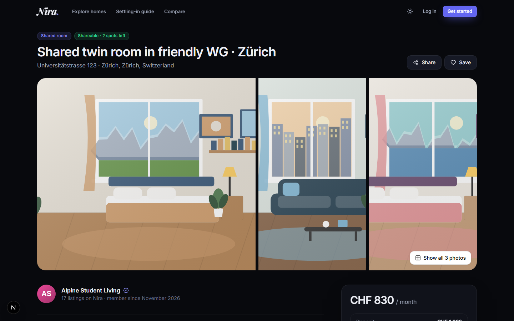
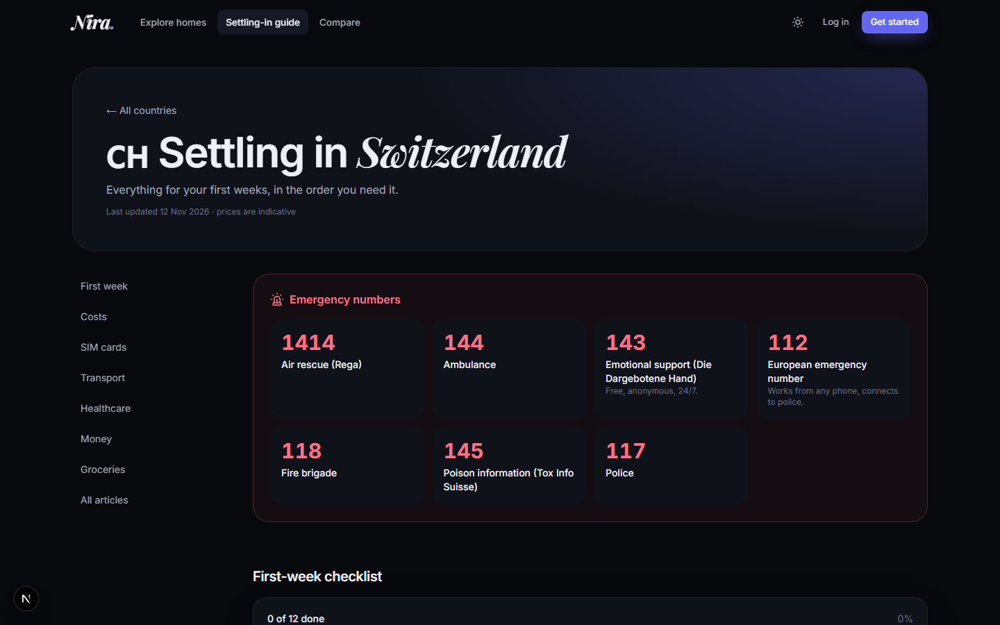
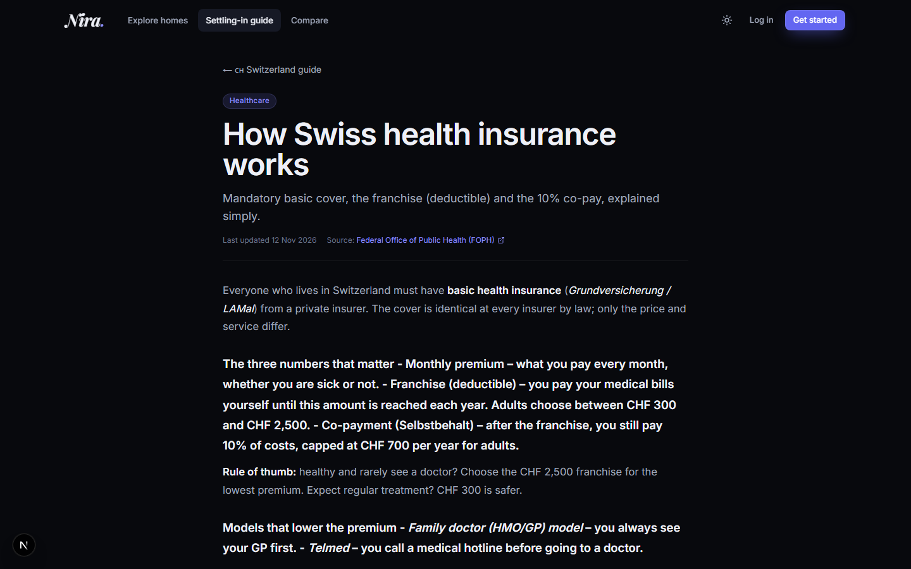
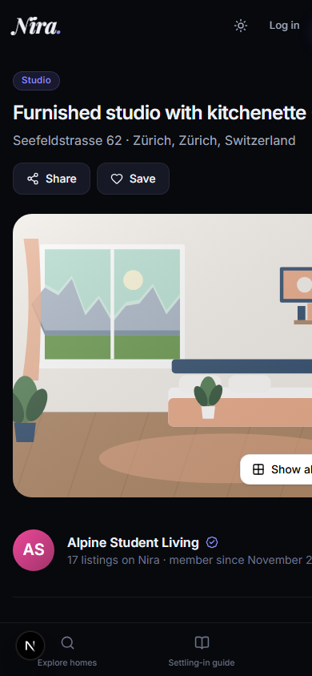
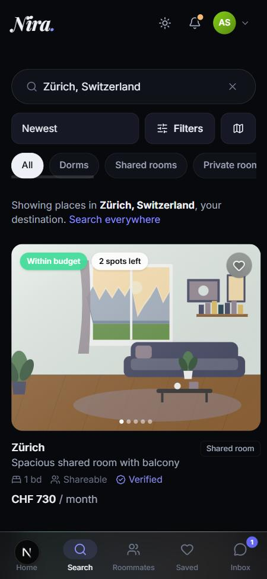
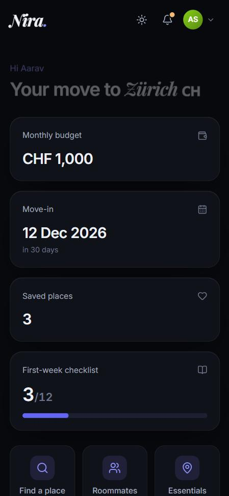
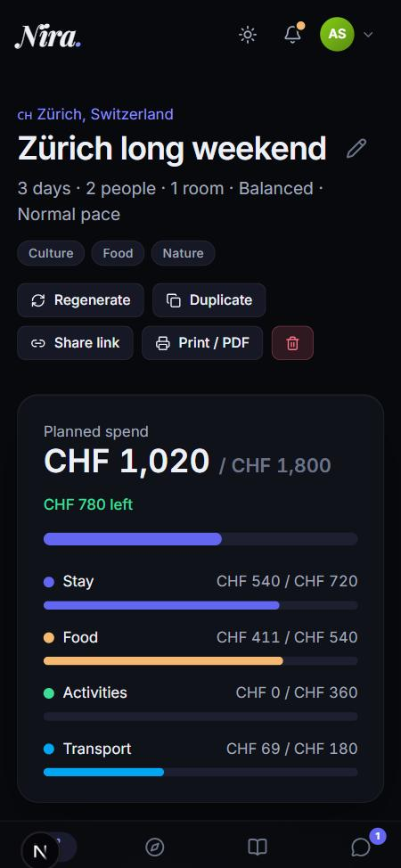

# Nira — DBMS Level 3 project report

**Title:** Nira — a relocation and budget-trip platform backed by MySQL and MongoDB
**Team:** mounika-200622 · pramitiudupa
**Stack:** Next.js 16 (App Router, Route Handlers) · TypeScript · Prisma 6 · MySQL 8 · MongoDB 7 · Tailwind CSS 4 · Leaflet/OpenStreetMap · Capacitor (Android)

---

## 1. Problem statement

People moving to a new country (students, interns, professionals) face the same problems in
the first weeks: finding an affordable place, finding people to share it with, knowing which
paperwork comes first (registration, insurance, bank, SIM), and finding the supermarket,
pharmacy and tram stop near a place they have never seen. Information is spread over listing
sites, Facebook groups, government pages and maps, and none of it is budget-aware. Travellers
have a smaller version of the same problem: a plan that fits a budget.

## 2. Objectives

1. One place to search housing with real filters, see who wants to share each place, and chat
   without exposing phone numbers or emails.
2. Score roommate compatibility from budgets, dates, gender preferences and lifestyle.
3. Show live nearby essentials around any place and estimate prices where the map has none.
4. A database-driven, editable settling-in guide with a personal checklist (complete for
   Switzerland, generic for any country).
5. Generate day-by-day trip plans that are mathematically guaranteed not to exceed the budget.
6. Detect where the person is (GPS) and turn it into local next steps for that country: SIM
   cards, buses/metro, taxi and ride-hailing apps, emergency numbers, today's exchange rate from
   their home currency and the nearest exchange offices.
7. Demonstrate a well-normalised relational design, advanced SQL objects and a justified
   NoSQL component, with security and integrity enforced at the database level.

## 3. Scope

**In scope:** three roles (USER, BUSINESS, ADMIN); listings with photos, amenities and rules;
search with pagination, map view and saved places; roommate requests with a transactional
accept; chat with read receipts, block and report; nearby essentials (OpenStreetMap Overpass,
cached); Swiss guide content, checklist, SIM/transport/healthcare/banking/groceries/costs and a
live Swiss timetable; trip planner with swap/regenerate/share/print; admin moderation and
content editing; location-aware "You're here" briefing (nearest city via `fn_distance_km`) with
SIM, transport, ride apps (`RideService`) and a home-currency converter (`ExchangeRate`);
per-country SIM/transport/ride data for 29+ countries; freely licensed real photos with credits;
installable PWA and an Android app that works over Wi-Fi (native GPS, Back button).

**Out of scope:** payments and contracts, identity verification, real-time push (polling is
used), automatic translation, menus/real prices for restaurants (estimates are used).

## 4. Functional requirements (summary)

| Area | Requirement |
|---|---|
| Accounts | Sign up as USER or BUSINESS (never ADMIN), bcrypt passwords, JWT sessions with id+role, onboarding, profile, change/reset password, delete account, rate-limited login/signup/chat. |
| Authorization | Page guard in `src/proxy.ts` + server-side checks on every API route (role, ownership, participation). |
| Listings | Business CRUD, archive, mark rented (stored procedure), geocoding with manual pin, photo upload/reorder/cover/captions, 1 view per visitor per day. |
| Search | Filters (location cascade, type, price, shareable, open spots, gender, date, bedrooms, amenities, furnished, keywords), sort incl. distance, 12 per page, state in URL, budget badge, map view. |
| Roommates | One OPEN request per person per listing, compatibility score, top matches, owner accept/decline, withdraw. |
| Chat | Either side can start, one conversation per pair+listing, unread counts, polling with `?after=`, read receipts, block/report. |
| Location | GPS (native in the app) or a picked city → nearest city → briefing: emergency numbers, cheapest SIM, ride apps with deep links, transit day pass, homes nearby, essentials, guide, trip. |
| Money | Home country on the profile; live rate + converter home → local currency; currency-exchange offices, banks and ATMs on the map. |
| Essentials | 18 categories around a point (incl. currency exchange), 0.5–5 km radius, price tiers and estimates, list + map, OSM/Google links. |
| Guide | Articles, checklist with progress, SIM plans, transport modes/passes, live connections, emergency numbers, banks, supermarkets, cost snapshot, full-text search, admin CRUD. |
| Trips | Budget split, style/pace/interests, day plans with clustering, budget meter, swap/add/remove/regenerate/duplicate/share/print. |
| Admin | Users (search, deactivate, verify, role), listing moderation, reports queue, content & cost CRUD, audit log, stats. |

## 5. Database design

### 5.1 ER diagram and relational schema
- ER diagrams (Mermaid, all 38 tables + 2 collections): [er-diagram.md](er-diagram.md)
- Relational schema / full DDL: [schema.sql](schema.sql) and `prisma/schema.prisma`
- Data dictionary (every column, type, key, CHECK and index): [data-dictionary.md](data-dictionary.md)
- Normalization and ON DELETE rules: [normalization.md](normalization.md)

**Entities (38 tables) by area:** accounts (User, UserProfile, BusinessProfile, Language,
UserLanguage, PasswordResetToken) · locations (Country, Region, City) · listings (Listing,
ListingPhoto, Amenity, ListingAmenity, SavedListing, ListingView) · social (RoommateRequest,
Conversation, Block, Report) · places & prices (POI, PoiQueryCache, CostEstimate, ExchangeRate) ·
guide (GuideArticle, ChecklistTemplate, UserChecklistProgress, SimProvider, SimPlan,
TransportMode, TransportPass, RideService, EmergencyNumber, SupermarketChain, Bank) · trips (Itinerary,
ItineraryInterest, ItineraryItem) · AuditLog.

**Key relationships:** User 1–1 UserProfile/BusinessProfile; User 1–N Listing; Country 1–N
Region 1–N City 1–N Listing; Listing M–N Amenity (ListingAmenity); User M–N Listing via
SavedListing and RoommateRequest; User–User via Conversation and Block; Itinerary 1–N
ItineraryItem N–1 POI/Listing; Country 1–N RideService; Country 1–N UserProfile (home country,
used for the currency converter).

### 5.2 Database choice and justification

| Data | Store | Why |
|---|---|---|
| Accounts, profiles, listings, locations, requests, guide, prices, trips, audit | **MySQL** | Strongly related data with integrity needs (FKs, UNIQUE, CHECK), multi-row transactions (accept request, mark rented, save itinerary), ad-hoc relational queries (joins, aggregates, windows), full-text search. |
| Chat message bodies, notifications | **MongoDB** | Append-only, high-volume, schema-flexible documents read by a single key in time order; TTL expiry; aggregation pipelines for counters. Details: [nosql-design.md](nosql-design.md). |

The conversation **header** stays in MySQL so uniqueness, blocks and cascades are enforced
relationally; only the bodies go to MongoDB.

## 6. SQL implementation

**DDL** — 10 Prisma migrations in `prisma/migrations/` (CREATE/ALTER/DROP; the v2 migration
renames v1's photo column to keep data and backfills ISO codes; it drops the unused v1 MySQL
`Message` table). Raw-SQL migration `20261112090100_sql_objects` adds:

| Object | Name | Used by |
|---|---|---|
| CHECK constraints (28) | `chk_listing_capacity`, `chk_listing_occupants`, `chk_itin_split`, `chk_ride_link`, … | every write |
| View | `v_listing_summary` | search, saved, dashboards, admin |
| View | `v_roommate_compatibility` | "Top matches for you" |
| Function | `fn_distance_km` (Haversine) | nearest sort, POI radius search, queries |
| Function | `fn_spots_left` | `v_listing_summary` |
| Procedure | `sp_mark_listing_rented` (transaction + `FOR UPDATE`) | "Mark as rented" |
| Trigger | `trg_listing_audit_au` | AuditLog of price/status changes |
| Trigger | `trg_listing_occupancy_bu` | full shareable listing → RENTED automatically |
| Triggers | `trg_request_open_bi/bu` | partial-unique "one OPEN request" rule |
| Triggers | `trg_conversation_bi`, `trg_block_bi` | rules MySQL can't express as CHECK |
| FULLTEXT | Listing(title, description), GuideArticle(title, summary, body) | keyword search |

**DML & queries** — 27 annotated queries with real output: [queries.sql](queries.sql)
(JOIN, GROUP BY/HAVING, sub-queries, NOT EXISTS, relational division, CTE, window functions
RANK/PERCENT_RANK/ROW_NUMBER/DENSE_RANK, FULLTEXT, view use, function, procedure, trigger
demos, transactions with row locks, upsert, cascading delete, DDL demo, EXPLAIN).

**Advanced concepts demonstrated (≥ 4 required):** transactions, views, stored procedure and
functions, triggers, indexing (117 indexes incl. composite and FULLTEXT), full-text search,
NoSQL aggregation, window functions, CHECK constraints.

### Transactions in the application
| Operation | Where | Technique |
|---|---|---|
| Accept roommate request | `src/lib/roommates.ts` | `SELECT … FOR UPDATE` on listing and request, rule check, conditional `UPDATE … WHERE currentOccupants < capacityMax`, close others when full |
| Mark listing rented | `sp_mark_listing_rented` | procedure-level transaction with row lock |
| Create conversation (+ first message) | `src/lib/chat.ts` | find-or-create in a transaction, then Mongo insert |
| Save / regenerate / duplicate itinerary | `src/lib/trip/generate.ts`, actions route | itinerary + interests + items atomically |
| Edit listing + amenities, photo reorder | listing routes | `$transaction` |
| Resolve report (+ archive / deactivate) | admin route | `$transaction` |
| Password reset | reset route | update password + burn all tokens |

### Indexing (see EXPLAIN in queries Q26–Q27)
`Listing(cityId, status, price)` serves the main search filter + sort; `Listing(status, createdAt)`
the "newest" sort; `Listing(lat, lng)` and `POI(category, lat, lng)` bounding boxes before
Haversine; `City(name)` global autocomplete; `Conversation(userAId|userBId, lastMessageAt)`
the inbox; `ListingView(listingId, viewerKey, viewedOn)` unique-daily-view counting;
`RoommateRequest(listingId, status)` open requests per listing; FK columns are all indexed.

## 7. Data validation, integrity and security

- **Validation in three layers:** zod schemas on every API input (`src/lib/validators/*`) →
  Prisma types → MySQL `NOT NULL`, `UNIQUE`, `CHECK`, FK and trigger rules. A database error
  that slips through (e.g. a CHECK) is mapped to a 400, never a 500.
- **Passwords:** bcrypt (cost 10), never returned; login compares against a dummy hash when the
  email doesn't exist (no timing enumeration). Reset tokens are random 256-bit values stored
  only as SHA-256 hashes, single use, 1-hour expiry.
- **Secrets:** only in `.env` (git-ignored); `.env.example` has placeholders.
- **Authorization:** role guard in the proxy *and* in every route; ownership checks for
  listings, photos, trips; participant checks for chat (same 404 for "missing" and "not
  yours"). Users are always selected with explicit `select` (no password hashes leak).
- **Abuse protection:** rate limits on login, signup, chat, uploads, geocoding, POI, reports.
  Uploaded files are validated by magic bytes and size. Callback URLs are restricted to
  same-site paths (no open redirect).
- **SQL injection:** all raw SQL uses Prisma's tagged templates (bound parameters).

## 8. System architecture

## 9. Application screenshots

Real screenshots of the running app (seeded demo data) are in [`docs/screenshots/`](screenshots).

| | |
|---|---|
|  |  |
| Landing page with the segmented search | Split-screen login |
|  |  |
| Listing detail (mosaic gallery, badges) | Switzerland guide (emergency numbers, sections) |
|  |  |
| Guide article with source and date | Listing on a phone |

| Phone (logged in as the demo user) | | | |
|---|---|---|---|
|  |  |  |  |
| Search with budget badge + tab bar | Relocation hub | Chat with read receipts | Trip budget meter |

## 10. Testing

- **Unit tests (Vitest, `npm test`) — 79 passing:** matching score (and the documented
  example), budget split/allocation/ledger (never exceeds), trip planner over 18 budget × style
  combinations, price-tier derivation, Haversine/bounding box/nearest-neighbour, authorization
  rules incl. open-redirect protection, all zod schemas, accept-request rules incl. the race,
  Overpass query building and parsing, Swiss duration parsing, admin schema generation.
- **Database tests:** every query in `docs/queries.sql` is executed by
  `scripts/docs/queries.ts`; trigger/CHECK/unique-rule violations are shown being rejected by
  MySQL; migrations were verified on an empty database and on a v1 database containing data;
  `prisma migrate diff` reports no drift.
- **Static checks:** `npm run lint` (0 problems), `npx tsc --noEmit` (0 errors), `npm run build`.
- **Manual QA script:** see [qa-checklist.md](qa-checklist.md).

## 11. Individual contribution

Commits alternate between the two members and are balanced. Both members have commits in the
database layer (schema, migrations, seed, SQL docs) and in the application (API, UI, tests).
The per-member breakdown by area is generated from the git history:
[contributions.md](contributions.md) (`npx tsx scripts/docs/contributions.ts`).

## 12. Conclusion and future enhancements

Nira shows how a relational core (constraints, transactions, views, procedure, triggers,
full-text search and window functions) and a document store for append-only data can work
together behind one web and mobile application, with the database itself enforcing the
important rules (occupancy, uniqueness, budgets, audit trail).

**Future work:** booking rides and SIMs inside the app through partner APIs; WebSockets/SSE instead of polling; semantic search over the guide with vector
embeddings; translated guide content; verified identity and digital lease signing; price
history charts from the audit log; deployment on a managed MySQL + MongoDB Atlas with
background jobs refreshing the place cache; offline reading of the guide in the app.
